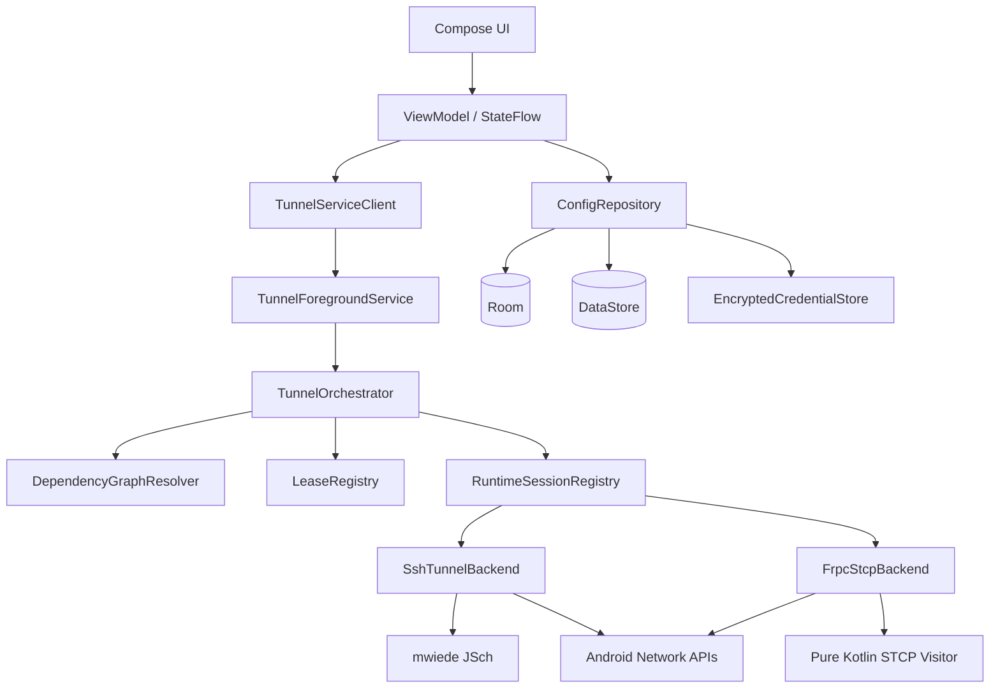
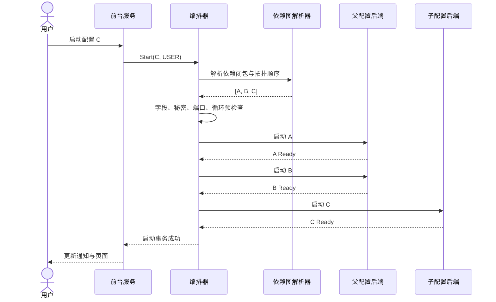
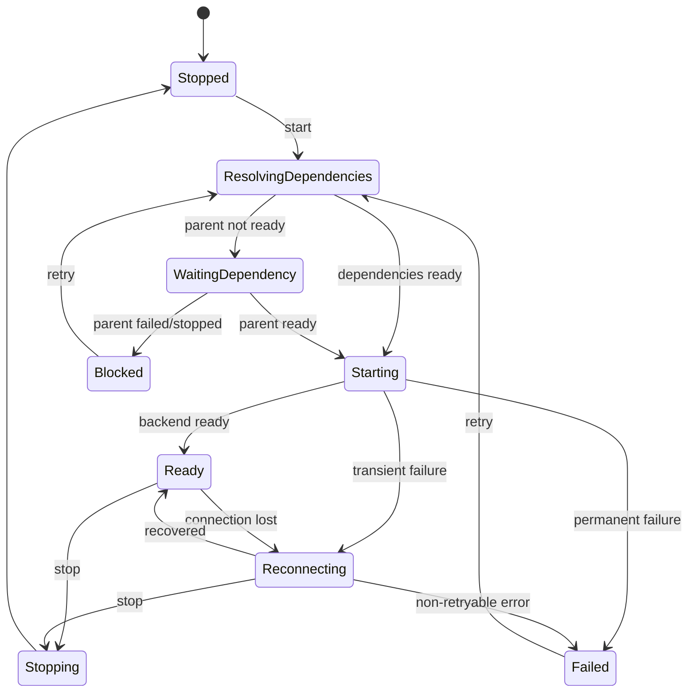

# PortWeave Android 端口映射应用开发设计文档

> 文档版本：1.1  
> 设计基线日期：2026-08-26  
> 目标平台：Android 8.0（API 26）及以上  
> 技术方向：原生 Kotlin、Jetpack Compose、协程、前台服务  
> 参考项目：[ycfeng/ocdeck-android](https://github.com/ycfeng/ocdeck-android)

---

## 目录

1. [项目概述](#1-项目概述)
2. [目标与非目标](#2-目标与非目标)
3. [参考项目复用策略](#3-参考项目复用策略)
4. [核心概念与用户场景](#4-核心概念与用户场景)
5. [功能需求](#5-功能需求)
6. [总体技术架构](#6-总体技术架构)
7. [工程结构与技术选型](#7-工程结构与技术选型)
8. [领域模型与数据存储](#8-领域模型与数据存储)
9. [依赖链与循环依赖检测](#9-依赖链与循环依赖检测)
10. [启动、停止与依赖租约](#10-启动停止与依赖租约)
11. [SSH 本地端口转发实现](#11-ssh-本地端口转发实现)
12. [frpc STCP visitor 实现](#12-frpc-stcp-visitor-实现)
13. [Android 后台运行与恢复](#13-android-后台运行与恢复)
14. [状态机、错误模型与重连](#14-状态机错误模型与重连)
15. [安全设计](#15-安全设计)
16. [日志、监控与诊断](#16-日志监控与诊断)
17. [UI 视觉与交互设计](#17-ui-视觉与交互设计)
18. [页面详细设计](#18-页面详细设计)
19. [配置校验规则](#19-配置校验规则)
20. [导入、导出与迁移](#20-导入导出与迁移)
21. [测试方案](#21-测试方案)
22. [性能与稳定性目标](#22-性能与稳定性目标)
23. [研发阶段与交付标准](#23-研发阶段与交付标准)
24. [风险与应对](#24-风险与应对)
25. [验收清单](#25-验收清单)
26. [参考资料与许可证](#26-参考资料与许可证)

---

## 1. 项目概述

### 1.1 产品定位

PortWeave 是一款原生 Android TCP 端口映射管理应用。用户可以创建多个映射配置，将远程 TCP 服务映射为 Android 设备上的本地监听端口，供同一设备上的浏览器、客户端应用、调试工具或其他进程连接。

首版仅支持两套后端：

1. **SSH 本地端口转发**：先建立 SSH 会话，再通过 SSH 将本地端口转发到远端网络中的目标地址。
2. **frpc STCP visitor**：Android 内嵌 visitor 客户端，通过 frps 与远端 STCP 服务端建立访问链路，并在 Android 本地创建监听端口。

每个配置都可以选择一个已存在的配置作为其“连接入口”。启动子配置时，应用会自动启动依赖配置，等待依赖配置真正可用后再继续启动子配置。配置关系允许形成链和分支，但禁止形成环。

### 1.2 核心产品原则

- **本地优先**：默认仅监听 `127.0.0.1`，不主动暴露给局域网。
- **明确可见**：后台维持映射时始终显示持续通知，用户随时可以查看和停止。
- **依赖可解释**：启动前展示完整链路，失败时明确指出发生问题的节点。
- **配置与运行分离**：持久化配置是静态定义，运行会话是带代次、租约和状态的动态对象。
- **秘密最小暴露**：数据库只保存秘密引用，密码、令牌和私钥以加密形式保存在应用私有目录。
- **不解析业务流量**：端口映射层只搬运 TCP 字节，不记录、分析或修改应用层数据。

---

## 2. 目标与非目标

### 2.1 首版目标

- 创建、编辑、复制、排序、启用、停用和删除映射配置。
- 支持 SSH 本地转发和 frpc STCP visitor 两套后端。
- 支持一个配置依赖另一个配置的本地输出端口。
- 启动子配置时自动启动依赖链，并按依赖顺序等待就绪。
- 在编辑、导入和运行前执行循环依赖检测。
- 支持网络切换后的自动恢复和可配置的重连策略。
- 支持运行状态、持续时间、重连次数、错误原因和脱敏日志查看。
- 支持系统主题、浅色主题、深色主题和可选动态取色。
- 使用定制化 Compose 组件，而不是直接堆叠无样式系统控件。
- 通过前台服务维持由用户主动启动的映射。

### 2.2 首版非目标

以下能力不进入首版，以避免协议面和系统权限快速膨胀：

- 通用 TCP 透明转发后端，以及 UDP、SUDP、XTCP、QUIC 转发。
- SSH 远程端口转发、动态 SOCKS 转发和交互式终端。
- 基于 `VpnService` 的全设备流量代理。
- HTTP 反向代理、TLS 终止、内容改写和请求缓存。
- root 权限、系统级端口重定向或修改系统路由表。
- 多设备配置云同步和多人协作。
- 在设备重启后无提示地恢复全部映射。
- 将本地监听地址开放到 `0.0.0.0`；首版固定为回环地址。

### 2.3 后续可扩展项

- IPv6 回环地址 `::1`。
- SSH 会话池和一个会话承载多个本地转发。
- 收藏配置的快捷设置磁贴。
- 加密配置包导入导出。
- 面向平板和折叠屏的更完整双栏工作区。
- 多命名输入依赖；首版每个配置只允许一个直接依赖。

---

## 3. 参考项目复用策略

### 3.1 可复用部分

参考项目已经实现并验证了以下边界：

- SSH 本地转发与 frpc STCP visitor 两种连接模型。
- 独立的 `frpc-stcp-visitor` 模块和稳定客户端接口。
- 纯 Kotlin STCP 后端，以及保留的 GoMobile 适配实现。
- SSH 主机指纹确认、私钥导入和连接状态管理。
- Compose Material 3、主题切换、DataStore 与 Android Keystore 的组合。

新应用应优先复用**协议实现、接口设计、兼容性测试经验和许可证声明**，而不是直接复制原产品的业务页面、命名和信息架构。

### 3.2 推荐复用方式

1. 将参考项目中的 `frpc-stcp-visitor` 抽取为独立 Gradle 模块。
2. 保留稳定接口层，在其外部增加本应用的会话池、指标和事件适配器。
3. 将 SSH 连接逻辑拆为独立 `SshTunnelBackend`，不让 UI 直接持有 JSch 对象。
4. 重新实现配置仓库、依赖图调度、前台服务和全部 Compose 页面。
5. 对复用代码保留原许可证文本、版权声明和必要的第三方 NOTICE。
6. 对参考项目中与当前产品无关的页面、浏览器逻辑或专有业务字段不做迁移。

### 3.3 复用边界

```text
可直接复用或改造：
  frpc STCP 协议客户端、配置结构、连接状态回调、协议兼容测试

建议参考后重写：
  SSH 生命周期、秘密存储、网络变化处理、日志脱敏

必须重新设计：
  数据库、依赖图、启动编排、前台服务、配置编辑器、首页和详情页
```

---

## 4. 核心概念与用户场景

### 4.1 本地输出

每个运行中的配置都会暴露一个稳定的本地输出：

```text
127.0.0.1:<localPort>
```

只有当底层连接已建立、监听端口已成功绑定且当前运行代次有效时，配置状态才可进入 `Ready`。

### 4.2 连接入口

连接入口决定当前配置的底层客户端向哪里拨号：

```kotlin
sealed interface EndpointSource {
    data class Remote(
        val host: String,
        val port: Int,
    ) : EndpointSource

    data class Dependency(
        val configId: UUID,
    ) : EndpointSource
}
```

不同类型对连接入口的解释如下：

| 配置类型 | 连接入口代表什么 |
|---|---|
| SSH | SSH 服务端的拨号地址，目标主机和目标端口另行配置 |
| STCP visitor | frps 的拨号地址，STCP 服务名和密钥另行配置 |

### 4.3 依赖示例

假设：

- 配置 A 通过 STCP 将远端 SSH 服务映射到 `127.0.0.1:10022`。
- 配置 B 使用 SSH 转发，将远端网络中的数据库 `10.20.0.15:5432` 映射到 `127.0.0.1:15432`。
- 配置 B 的 SSH 连接入口选择“依赖配置 A”。

启动 B 时执行：

```text
启动 A
  ↓
等待 A Ready
  ↓
B 连接 127.0.0.1:10022
  ↓
验证预先保存的 SSH 主机身份
  ↓
建立 SSH 转发
  ↓
B 在 127.0.0.1:15432 Ready
```

用户只需启动 B，A 会随同启动。停止 B 时，只有在 A 没有手动运行租约、也没有其他运行中的子配置依赖它时，A 才会自动停止。

### 4.4 典型用户故事

- 用户通过 SSH 节点访问远端内网数据库，并由本地数据库客户端连接。
- 用户先通过 STCP 获得远端 SSH 服务的本地入口，再基于该入口建立第二层 SSH 转发。
- 用户点击某个深层配置后，应用自动计算并启动完整依赖链。
- 用户编辑依赖关系时，应用立即指出可能产生的环，并禁止保存。
- 网络从 Wi-Fi 切换到蜂窝网络后，应用按依赖顺序恢复运行中的配置。
- 用户在详情页复制脱敏诊断信息，而不会复制令牌、密码或私钥。

---

## 5. 功能需求

### 5.1 配置管理

每个配置至少包含：

- 唯一 ID。
- 名称和可选说明。
- 类型：SSH、STCP visitor。
- 本地端口。
- 连接入口：SSH 服务端或 frps 地址，或依赖配置。
- 自动恢复开关。
- 连接超时、握手超时和重连策略。
- 排序位置、标签和收藏状态。
- 创建时间、更新时间和配置修订号。

配置操作：

- 新建、编辑、复制、删除。
- 启动、停止、重启。
- 批量启动收藏项、批量停止全部。
- 导出单个或多个配置。
- 按名称、类型、状态和标签筛选。
- 拖动排序或按最近使用排序。

### 5.2 运行控制

- 启动前执行依赖、端口、秘密和字段完整性检查。
- 自动按父配置优先的顺序启动。
- 子配置只在直接依赖进入 `Ready` 后启动。
- 支持多个子配置共享同一个运行中的父配置。
- 支持同一配置的并发启动请求合并为一次实际启动。
- 支持停止单个配置、停止依赖子树、停止全部。
- 中途失败时，只回滚本次启动事务新增且不再被其他会话需要的节点。
- 修改运行中的配置后，标记为“配置已变化”，由用户选择立即重启或稍后应用。

### 5.3 状态与诊断

- 显示当前状态、阶段说明、持续时间和最近错误。
- 显示依赖链以及每个节点的状态。
- 显示重连次数、最近一次成功时间和网络变化次数。
- 纯 Kotlin STCP 后端显示收发字节及活动连接数；SSH 后端按能力声明显示可用指标。
- 后端不支持某项指标时，UI 显示“此模式暂不提供”，不得伪造数值。
- 日志默认保存最近 7 天，每个配置最多 1,000 条结构化事件。
- 支持日志筛选、复制、导出和一键清空。

---

## 6. 总体技术架构

### 6.1 分层结构



### 6.2 关键组件职责

#### `ConfigRepository`

- 对 Room、DataStore 和秘密存储提供统一事务边界。
- 保存前构造候选依赖图并校验。
- 对 UI 暴露不可变配置模型和 `Flow`。
- 处理配置修订号和导入冲突。

#### `TunnelForegroundService`

- 持有长生命周期协程作用域。
- 在用户发起运行请求后及时进入前台状态。
- 维护持续通知和通知操作。
- 进程被系统回收后，在平台允许的条件下重建“期望运行”的配置。

#### `TunnelOrchestrator`

- 解析依赖闭包和拓扑顺序。
- 执行启动前检查。
- 管理运行租约、单次启动事务和失败回滚。
- 将后端状态统一转换为领域状态。
- 在网络变化、服务重建和配置变化时安排恢复。

#### `RuntimeSessionRegistry`

- 保存当前进程内的运行会话。
- 每个配置维护单调递增的 `generation`。
- 防止旧协程、旧回调或旧清理任务影响新会话。
- 合并同一配置的并发启动请求。

#### `TunnelBackend`

```kotlin
interface TunnelBackend {
    val kind: TunnelKind

    suspend fun start(
        config: ResolvedTunnelConfig,
        generation: Long,
        eventSink: TunnelEventSink,
    ): BackendHandle

    suspend fun stop(
        handle: BackendHandle,
        timeout: Duration,
    )

    suspend fun probe(handle: BackendHandle): ProbeResult
}

interface BackendHandle {
    val localEndpoint: LocalEndpoint
    val state: StateFlow<BackendState>
    val capabilities: BackendCapabilities
}
```

后端不得直接读数据库、弹出页面或修改 Compose 状态。

### 6.3 线程与协程模型

- 服务级作用域：`SupervisorJob + Dispatchers.IO`。
- 编排器使用单个命令 Actor 串行处理状态变更。
- 实际拨号、监听和流量转发在独立子协程中执行。
- 每个配置最多存在一个当前代次。
- 后端事件带上 `configId + generation`，不匹配当前代次的事件直接丢弃。
- 数据库写入通过单独的 IO 调度器和短事务执行。
- UI 只收集 `StateFlow`，不直接轮询 Socket 或服务对象。

---

## 7. 工程结构与技术选型

### 7.1 推荐 Gradle 模块

```text
:app
  Compose 页面、导航、ViewModel、前台服务、通知、应用入口

:core
  领域模型、Room、DataStore、秘密存储、日志、通用校验

:tunnel-engine
  依赖图、编排器、租约、SSH 后端、STCP 后端适配器、统一状态机

:frpc-stcp-visitor
  从参考项目抽取和适配的纯 Kotlin STCP visitor

:test-support
  假后端、测试服务器、配置构造器、虚拟时钟
```

首版不继续拆分为大量 feature 模块。页面代码可在 `:app` 内按功能包组织，待编译时间或团队协作确有需要时再拆分。

### 7.2 技术基线

建议以参考项目已验证的构建组合为起点，并锁定版本后再开发：

- Kotlin 2.4.x。
- Gradle 9.6.x。
- Android Gradle Plugin 9.2.x。
- JDK 21。
- `minSdk 26`。
- `compileSdk 36`、`targetSdk 36`。
- Jetpack Compose + Material 3。
- Kotlin Coroutines / Flow。
- Room + KSP。
- Preferences DataStore。
- Android Keystore + AES-GCM 加密秘密记录。
- mwiede JSch 2.28.x。
- Bouncy Castle，用于 Android 上部分现代 SSH 密钥算法。
- 纯 Kotlin frpc STCP visitor 作为正式构建默认后端。

具体依赖版本应通过版本目录统一锁定，并由兼容性测试决定升级，不以“自动追随最新版本”为策略。

### 7.3 依赖注入

采用小型手动容器 `AppContainer`：

```kotlin
class AppContainer(application: Application) {
    val database: AppDatabase = ...
    val credentialStore: CredentialStore = ...
    val configRepository: ConfigRepository = ...
    val backendRegistry: BackendRegistry = ...
    val orchestratorFactory: TunnelOrchestratorFactory = ...
}
```

原则：

- 依赖通过构造函数传入。
- 不使用可变全局单例保存运行状态。
- 服务对象由 `Application` 容器创建，但生命周期由服务自身管理。
- 测试使用 `FakeClock`、`FakeNetworkMonitor` 和 `FakeTunnelBackend` 替换真实依赖。

---

## 8. 领域模型与数据存储

### 8.1 领域模型

```kotlin
data class TunnelConfig(
    val id: UUID,
    val name: String,
    val description: String?,
    val localPort: Int,
    val spec: TunnelSpec,
    val autoRecover: Boolean,
    val retryPolicy: RetryPolicy,
    val tags: Set<String>,
    val favorite: Boolean,
    val sortOrder: Long,
    val revision: Long,
    val createdAt: Instant,
    val updatedAt: Instant,
)

sealed interface TunnelSpec {
    data class Ssh(
        val sshEndpoint: EndpointSource,
        val identity: SshServerIdentity,
        val username: String,
        val auth: SshAuthRef,
        val remoteTargetHost: String,
        val remoteTargetPort: Int,
        val hostKeyPolicy: HostKeyPolicy,
        val keepAliveInterval: Duration,
    ) : TunnelSpec

    data class Stcp(
        val frpsEndpoint: EndpointSource,
        val identity: FrpsServerIdentity,
        val tokenRef: CredentialRef?,
        val user: String?,
        val serverUser: String?,
        val serverName: String,
        val secretKeyRef: CredentialRef,
        val wireProtocol: StcpWireProtocol,
        val useEncryption: Boolean,
        val useCompression: Boolean,
        val tlsLeafPinSha256: String?,
    ) : TunnelSpec
}
```

### 8.2 拨号地址与服务身份分离

配置依赖另一个本地输出时，实际拨号地址通常变为 `127.0.0.1:<parentPort>`，但安全校验仍应针对原始服务身份。

因此必须区分：

- **Dial Endpoint**：Socket 实际连接的地址。
- **Logical Identity**：SSH 主机指纹或 frps TLS 身份所对应的原始主机标识。

例如 SSH 通过依赖链连接时：

```text
拨号地址：127.0.0.1:10022
逻辑身份：ssh.internal.example:22
主机指纹：SHA256:...
```

不得因为拨号地址变成回环地址而跳过主机身份校验。

### 8.3 Room 表设计

#### `tunnel_config`

| 字段 | 类型 | 说明 |
|---|---|---|
| `id` | TEXT PK | UUID |
| `name` | TEXT | 展示名称 |
| `description` | TEXT NULL | 说明 |
| `type` | TEXT | SSH / STCP |
| `local_port` | INTEGER | 本地监听端口 |
| `dependency_config_id` | TEXT NULL | 直接依赖配置 ID |
| `auto_recover` | INTEGER | 是否自动恢复 |
| `retry_policy_json` | TEXT | 重连策略 |
| `favorite` | INTEGER | 收藏 |
| `sort_order` | INTEGER | 排序 |
| `revision` | INTEGER | 修订号 |
| `created_at` | INTEGER | 时间戳 |
| `updated_at` | INTEGER | 时间戳 |

`dependency_config_id` 使用自引用外键并设置 `ON DELETE RESTRICT`。删除父配置前必须先解除所有子配置的依赖。

#### `ssh_detail`

保存 SSH 地址、逻辑身份、用户名、认证方式、目标地址、目标端口、主机指纹策略、超时和保活参数。密码和私钥正文不进入该表。

#### `stcp_detail`

保存 frps 地址、逻辑身份、用户、服务名、协议版本、加密和压缩开关、证书指纹。令牌与 STCP 密钥不进入该表。

#### `credential_ref`

| 字段 | 说明 |
|---|---|
| `id` | 随机 UUID |
| `owner_config_id` | 所属配置 |
| `kind` | PASSWORD / PRIVATE_KEY / TOKEN / STCP_SECRET |
| `storage_alias` | 加密秘密存储中的记录别名 |
| `version` | 轮换版本 |
| `updated_at` | 修改时间 |

#### `tunnel_event`

保存结构化事件，不保存网络载荷：

```text
id, config_id, generation, level, event_code,
message_key, sanitized_args_json, occurred_at
```

#### `desired_runtime`

保存用户明确希望保持运行的根配置 ID。依赖节点由编排器动态推导，不单独持久化为根意图。

### 8.4 DataStore 内容

- 主题模式：跟随系统、浅色、深色。
- 动态取色开关。
- 首页布局密度。
- 日志保留周期。
- 通知行为。
- 默认超时和重连策略。
- 是否显示高级字段。

### 8.5 数据事务

保存配置时执行一个逻辑事务：

1. 读取现有配置快照。
2. 在内存中应用候选修改。
3. 校验字段、悬空依赖和循环依赖。
4. 写入或轮换秘密记录。
5. 在 Room 事务中更新主表和类型详情表。
6. 成功后删除不再使用的旧秘密记录。
7. 配置修订号加一并通知运行层。

若数据库提交失败，不删除旧秘密；若秘密写入成功但数据库失败，记录临时别名并由清理任务回收。

---

## 9. 依赖链与循环依赖检测

### 9.1 图模型

首版每个配置最多直接依赖一个配置，因此图是“每个节点最多一条父边”的有向图，但仍可能包含：

- 多级链：`A ← B ← C`。
- 分支：A 同时被 B、C 依赖。
- 多个互不相关的连通分量。
- 错误环：`A ← B ← C ← A`。

本文约定：

```text
child.dependencyConfigId = parent.id
```

启动顺序必须是父配置在前，停止依赖子树时则反向执行。

### 9.2 校验时机

循环检测必须在以下位置重复执行：

1. **编辑器即时检查**：用户选择依赖时立刻反馈。
2. **保存事务检查**：不相信 UI，保存前检查完整候选图。
3. **导入检查**：整个导入包一次性构图，发现任何环则整批拒绝。
4. **运行前检查**：防御数据库损坏、旧版本缺陷或外部恢复造成的异常数据。

### 9.3 DFS 三色检测

```kotlin
enum class VisitState {
    VISITING,
    VISITED,
}

data class ConfigNode(
    val id: UUID,
    val name: String,
    val dependencyConfigId: UUID?,
)

fun findDependencyCycle(
    configs: Collection<ConfigNode>,
): List<UUID>? {
    val byId = configs.associateBy(ConfigNode::id)
    val state = mutableMapOf<UUID, VisitState>()
    val path = mutableListOf<UUID>()
    val pathIndex = mutableMapOf<UUID, Int>()

    fun dfs(id: UUID): List<UUID>? {
        state[id] = VisitState.VISITING
        pathIndex[id] = path.size
        path += id

        val parentId = byId[id]?.dependencyConfigId
        if (parentId != null) {
            require(parentId in byId) {
                "Dangling dependency: $id -> $parentId"
            }

            when (state[parentId]) {
                VisitState.VISITING -> {
                    val start = pathIndex.getValue(parentId)
                    return path.subList(start, path.size).toList() + parentId
                }

                VisitState.VISITED -> Unit
                null -> dfs(parentId)?.let { return it }
            }
        }

        pathIndex.remove(id)
        path.removeAt(path.lastIndex)
        state[id] = VisitState.VISITED
        return null
    }

    for (id in byId.keys) {
        if (state[id] == null) {
            dfs(id)?.let { return it }
        }
    }
    return null
}
```

时间复杂度为 `O(V + E)`，首版中 `E ≤ V`。

### 9.4 错误呈现

检测到环时不得只显示“配置不合法”，而应给出完整路径：

```text
无法保存：该依赖会形成循环
开发数据库 → SSH 入口 → STCP 链路 → 开发数据库
```

交互要求：

- 保存按钮保持禁用。
- 依赖选择器中禁用当前配置及其所有传递子节点。
- 禁用项仍显示名称，并附带“选择后会形成循环”的说明。
- 路径中的配置卡使用错误描边，但不只依赖颜色；同时显示图标和文字。

### 9.5 悬空依赖

发现 `dependencyConfigId` 指向不存在的配置时：

- 保存候选配置时直接拒绝。
- 导入时标记具体缺失 ID 和引用它的配置。
- 运行时进入 `Blocked(DependencyMissing)`，不尝试连接。
- 不自动把悬空依赖改为直接拨号入口，避免产生意外网络连接。

### 9.6 删除规则

父配置仍有子配置时，普通删除操作被阻止。删除对话框显示直接和传递依赖数量，并提供两个明确操作：

- 返回配置列表。
- “解除这些依赖并删除”：在同一事务中将直接子配置改为未完成状态，再删除父配置。

不提供静默级联删除。

---

## 10. 启动、停止与依赖租约

### 10.1 启动流程



具体步骤：

1. 获取根配置启动请求。
2. 解析完整依赖闭包。
3. 检查环、悬空引用、秘密缺失、本地端口冲突和配置字段。
4. 计算父配置优先的拓扑序。
5. 创建 `StartTransactionId`。
6. 依次为每个节点获取租约。
7. 已经 `Ready` 的节点直接复用。
8. 正在启动的节点复用其 `Deferred<StartResult>`。
9. 未运行节点创建新代次并启动。
10. 每个子节点在直接父节点 `Ready` 后继续。
11. 全部成功后，将根配置写入 `desired_runtime`。

### 10.2 启动租约

```kotlin
sealed interface StartLease {
    data object User : StartLease
    data class Dependent(val childConfigId: UUID) : StartLease
    data class Restore(val rootConfigId: UUID) : StartLease
}
```

每个运行配置维护一个租约集合：

```text
A leases = {
  User,
  Dependent(B),
  Dependent(C)
}
```

配置仅在以下条件全部满足时自动停止：

- 没有用户租约。
- 没有恢复租约。
- 没有运行中的子配置租约。
- 当前没有尚未完成的启动事务需要它。

### 10.3 单飞启动

多个请求同时启动同一配置时，只允许一次真实连接：

```kotlin
private val inFlightStarts = mutableMapOf<UUID, Deferred<StartResult>>()
```

后续请求等待现有 `Deferred`。完成后由 Actor 在同一串行上下文中移除条目，避免检查和插入之间产生竞态。

### 10.4 启动失败回滚

若链 `A → B → C` 在启动 C 时失败：

- C 停止并释放本次事务租约。
- B 若本次事务前已运行，则保持不变。
- B 若由本次事务新启动，但还有其他租约，则保持运行。
- B 若只被本次事务需要，则停止。
- A 按同样规则递归处理。

该策略避免因一个子配置失败而停止用户原本正在使用的父配置。

### 10.5 停止规则

#### 停止叶子配置

- 先停止叶子后端。
- 释放其对父配置的 `Dependent` 租约。
- 父配置无其他租约时继续向上停止。

#### 停止仍有运行子节点的父配置

默认不立即执行，显示受影响配置列表：

```text
停止“STCP 入口”还会停止：
• 开发 SSH
• 开发数据库
```

用户确认后按反向拓扑序停止子节点，再停止父节点。

#### 停止全部

- 获取当前运行图快照。
- 按叶子到根的顺序停止。
- 清空用户期望运行集合。
- 对超时后端执行强制关闭并记录 `STOP_TIMEOUT`。

### 10.6 编辑运行中配置

保存配置时修订号增加。若该配置或其传递子节点正在运行：

- 当前会话继续使用启动时的不可变快照。
- 页面显示“有未应用的修改”。
- 用户可选择“重启并应用”。
- 重启采用依赖感知的滚动方式：先停止受影响子树，再从根到叶重新启动。

---

## 11. SSH 本地端口转发实现

### 11.1 字段

- SSH 连接入口：远程地址或依赖配置。
- 逻辑主机名和逻辑端口。
- 用户名。
- 认证方式：密码、私钥、私钥加密码。
- SSH 主机身份策略：首次确认或固定 SHA-256 指纹。
- 远端目标主机和端口。
- 连接超时、认证超时、保活间隔。
- 自动恢复开关。

### 11.2 首版后端方案

首版使用 mwiede JSch 的 SSH Session 与本地端口转发能力：

1. 将 `EndpointSource` 解析成实际拨号地址。
2. 创建 JSch Session。
3. 在认证前验证主机身份。
4. 完成认证。
5. 调用本地转发 API 绑定 `127.0.0.1:localPort`。
6. API 成功返回且 Session 仍连接时进入 `Ready`。
7. 监听 Session 断开并进入恢复流程。

后续若需要统一的每连接字节指标，可改为由应用自己监听本地端口，并为每个客户端连接创建 `direct-tcpip` Channel。该升级应保持 `TunnelBackend` 接口不变。

### 11.3 主机身份校验

支持两种策略：

#### 首次确认

- 第一次连接只完成主机密钥交换，不先提交密码或私钥签名。
- 向用户展示 SHA-256 指纹和算法。
- 用户确认后保存逻辑主机身份与指纹。
- 后续不匹配时停止连接，不允许自动覆盖。

#### 固定指纹

- 用户预先输入或导入 SHA-256 指纹。
- 每次连接严格匹配。
- 不匹配进入不可自动重试错误 `SSH_HOST_KEY_MISMATCH`。

### 11.4 依赖模式下的身份处理

当 SSH 实际连接 `127.0.0.1:<parentPort>` 时，主机身份索引仍使用 `SshServerIdentity`：

```kotlin
data class SshServerIdentity(
    val logicalHost: String,
    val logicalPort: Int,
)
```

实现方式可以是自定义 `HostKeyRepository`，按逻辑身份取出固定指纹并验证实际握手得到的密钥。不得把 `127.0.0.1` 当成新的可信身份。

### 11.5 私钥处理

- 使用系统文件选择器导入私钥。
- 最大文件大小建议 256 KiB。
- 读取后复制到加密秘密存储，不在日志中记录 URI 或文件名。
- 不把私钥内容转换成长期存在的普通 `String`。
- 密码短语与私钥分开存储和轮换。
- 配置导出默认不包含私钥。

### 11.6 目标地址语义

SSH 的 `remoteTargetHost` 由 SSH 服务端所在网络解析和连接，而不是由 Android 本地解析。编辑器需在字段下方明确提示这一点，减少用户把本地 DNS 结果误认为远端结果。

### 11.7 会话池策略

首版每个 SSH 配置使用独立 Session，优点是：

- 故障隔离清晰。
- 停止和重连语义简单。
- 不同配置可以使用不同认证、保活和身份策略。

当实际使用表明同一 SSH 服务上存在大量映射时，再新增 `SshSessionPool`。池键必须包含逻辑身份、用户名、认证凭据版本、拨号入口、算法策略和网络代次。

---

## 12. frpc STCP visitor 实现

### 12.1 集成目标

将参考项目的纯 Kotlin STCP visitor 作为正式后端，使常规构建不依赖 Go、NDK 和额外原生 ABI。保留 GoMobile 适配器仅用于协议对照测试或紧急回退构建，不进入默认发行包。

### 12.2 稳定接口

建议保留参考模块的六类操作：

```kotlin
interface FrpcStcpVisitorClient {
    suspend fun startSession(config: FrpcSessionConfig): SessionId
    suspend fun ensureVisitor(sessionId: SessionId, config: StcpVisitorConfig): VisitorId
    suspend fun waitVisitorReady(visitorId: VisitorId, timeout: Duration): VisitorReady
    suspend fun stopVisitor(visitorId: VisitorId)
    suspend fun stopSession(sessionId: SessionId)
    fun getState(sessionId: SessionId): StateFlow<FrpcState>
}
```

应用层新增适配器，将这些操作转换为统一 `BackendHandle`、结构化事件和指标。

### 12.3 配置映射

| 应用字段 | STCP visitor 字段 |
|---|---|
| frps 拨号入口 | serverAddr / serverPort |
| 逻辑服务身份 | TLS SNI、证书指纹索引 |
| frpc 用户 | user |
| STCP 服务端用户 | serverUser |
| 服务名 | serverName |
| STCP 密钥 | secretKey |
| 本地端口 | bindPort |
| 固定回环地址 | bindAddr = 127.0.0.1 |
| 加密开关 | transport.useEncryption |
| 压缩开关 | transport.useCompression |

### 12.4 依赖模式下的 TLS 身份

STCP 配置依赖另一个本地输出时：

```text
实际拨号：127.0.0.1:<parentPort>
TLS 服务名：用户保存的 frps 原始主机名
证书校验：原始主机名或固定叶证书 SHA-256 指纹
```

因此纯 Kotlin visitor 的会话配置需要支持将以下字段分开：

```kotlin
data class FrpcDialTarget(
    val dialHost: String,
    val dialPort: Int,
    val tlsServerName: String?,
    val tlsLeafPinSha256: String?,
)
```

若当前复用模块把 `remoteHost` 同时用于拨号和 TLS 身份，应先扩展接口，再接入依赖功能。

### 12.5 会话池

多个 STCP 配置可能使用相同 frps、用户、令牌和协议版本。推荐引入引用计数会话池：

```kotlin
data class FrpcSessionKey(
    val resolvedDialEndpoint: InetSocketAddress,
    val logicalIdentity: FrpsServerIdentity,
    val credentialAlias: String?,
    val credentialVersion: Long,
    val user: String?,
    val wireProtocol: StcpWireProtocol,
    val tlsPin: String?,
    val networkGeneration: Long,
)
```

- 池键不包含明文令牌。
- 一个会话可承载多个 visitor。
- 每个 visitor 仍对应一个本地端口和一个应用配置。
- 释放最后一个 visitor 后再关闭会话。
- 网络切换时旧会话代次失效，重新建立并恢复 visitor。

若首个迭代希望降低复杂度，可先做“一配置一会话”，但 `FrpcStcpBackend` 外部接口和会话创建代码应预留池化边界。

### 12.6 就绪判定

STCP 的 `Ready` 至少要求：

1. 当前 frps 控制连接已完成登录。
2. visitor 已注册到当前会话代次。
3. 本地监听端口已成功绑定。
4. `waitVisitorReady` 在超时内返回成功。

不要通过向本地端口写入测试字节判断业务服务可用，因为应用不知道上层协议，探测数据可能产生副作用。

### 12.7 协议兼容测试

- Kotlin visitor 与官方 frps、frpc 服务端配置交叉测试。
- 覆盖支持的线协议版本。
- 覆盖加密、压缩、令牌、用户前缀和证书指纹。
- 对照 GoMobile 后端的连接结果和错误类型。
- 固定一组可重复执行的协议测试向量。
- 每次更新参考模块或 frp 协议代码时执行完整兼容套件。

---

## 13. Android 后台运行与恢复

### 13.1 服务模型

使用同进程、Started + Bound 的前台服务：

```xml
<uses-permission android:name="android.permission.INTERNET" />
<uses-permission android:name="android.permission.ACCESS_NETWORK_STATE" />
<uses-permission android:name="android.permission.POST_NOTIFICATIONS" />
<uses-permission android:name="android.permission.FOREGROUND_SERVICE" />
<uses-permission android:name="android.permission.FOREGROUND_SERVICE_SPECIAL_USE" />

<service
    android:name=".service.TunnelForegroundService"
    android:exported="false"
    android:foregroundServiceType="specialUse">
    <property
        android:name="android.app.PROPERTY_SPECIAL_USE_FGS_SUBTYPE"
        android:value="Maintains user-started local TCP listeners and remote forwarding sessions" />
</service>
```

使用 `specialUse` 的原因是持续端口映射不应伪装成一次性的 `dataSync` 工作；同时该类型需要在发布渠道中按平台要求提供用途说明和接受审核。

### 13.2 启动来源

首版只允许以下明确用户操作触发新映射：

- 应用页面中的启动按钮。
- 持续通知中的恢复或启动操作。
- 后续版本的快捷设置磁贴。

应用不在普通后台广播中随意新建前台服务。设备重启后默认不自动恢复全部映射。

### 13.3 前台时序

- 收到启动命令后立即创建服务。
- 在系统规定的短时间窗口内调用 `ServiceCompat.startForeground()`。
- 通知先显示“正在准备映射”，无需等待网络握手完成。
- 没有任何期望运行配置和活动会话时，停止前台状态并结束服务。

### 13.4 持续通知

通知频道：`Port mappings`，默认低打扰级别。

通知内容：

```text
PortWeave · 3 个映射运行中
2 个就绪 · 1 个正在重连
```

操作：

- 打开应用。
- 停止全部。
- 当全部处于可恢复错误时显示“立即重试”。

通知中不得显示密码、令牌、私钥路径和完整敏感主机信息。锁屏上可使用简化文本。

### 13.5 进程恢复

建议服务返回 `START_STICKY`，并将用户根配置的“期望运行”集合持久化。系统重建服务时：

1. 立即恢复前台通知。
2. 读取根配置意图。
3. 重新计算依赖图，而不是恢复旧 Socket。
4. 创建新的网络代次和会话代次。
5. 按拓扑顺序重建。

以下情况不自动恢复：

- 用户在系统设置中强制停止应用。
- 用户在应用中执行“停止全部”。
- 配置已经失效、秘密缺失或出现环。
- 设备重启；首版不注册自动启动流程。

### 13.6 网络变化

使用 `ConnectivityManager.NetworkCallback` 监听默认网络：

- `onAvailable`：唤醒等待网络的会话。
- `onLost`：将相关会话标记为 `Reconnecting(NetworkLost)`。
- `onCapabilitiesChanged`：检测网络是否可用，不保存网络名称等非必要信息。

网络变化使 `networkGeneration` 增加。旧代次产生的回调不得恢复到 `Ready`。

### 13.7 电量策略

- 不默认申请忽略电池优化。
- 不持有永久 WakeLock。
- 无网络时暂停重试计时器，等待网络回调。
- 重连使用有抖动的指数退避。
- 后台持续运行的必要性通过持续通知明确表达。
- 在帮助页说明部分厂商系统可能额外限制后台网络，并提供跳转到应用电池设置的按钮。

---

## 14. 状态机、错误模型与重连

### 14.1 统一状态

```kotlin
sealed interface TunnelState {
    data object Stopped : TunnelState
    data object ResolvingDependencies : TunnelState
    data class WaitingDependency(val parentId: UUID) : TunnelState
    data class Starting(val stage: StartStage) : TunnelState
    data class Ready(val since: Instant) : TunnelState
    data class Reconnecting(val attempt: Int, val nextRetryAt: Instant?) : TunnelState
    data object Stopping : TunnelState
    data class Blocked(val reason: BlockReason) : TunnelState
    data class Failed(val error: TunnelError) : TunnelState
}
```

### 14.2 状态转换



### 14.3 类型化错误

```kotlin
enum class TunnelErrorCode {
    CONFIG_INVALID,
    DEPENDENCY_MISSING,
    DEPENDENCY_CYCLE,
    DEPENDENCY_UNAVAILABLE,
    PORT_IN_USE,
    NETWORK_UNAVAILABLE,
    DNS_FAILED,
    CONNECT_TIMEOUT,
    CONNECTION_REFUSED,
    SSH_HOST_KEY_MISMATCH,
    SSH_AUTH_FAILED,
    SSH_FORWARD_FAILED,
    FRPS_AUTH_FAILED,
    STCP_VISITOR_NOT_READY,
    TLS_IDENTITY_MISMATCH,
    SECRET_MISSING,
    STOP_TIMEOUT,
    INTERNAL,
}
```

后端将第三方异常转换成类型化错误，不允许 UI 通过解析异常字符串决定行为。

### 14.4 可重试分类

#### 可重试

- 网络暂时不可用。
- DNS 暂时失败。
- 连接超时或被拒绝。
- SSH/FRPS 会话意外断开。
- 父配置暂时重连。

#### 默认不可自动重试

- 配置字段非法。
- 循环或悬空依赖。
- 本地端口被其他配置占用。
- SSH 主机指纹不匹配。
- TLS 身份不匹配。
- 密码、令牌、私钥或 STCP 密钥缺失。
- 明确的认证失败。

认证失败默认暂停重试，防止持续消耗网络和触发服务端限制。用户修改秘密或手动点击重试后再继续。

### 14.5 退避策略

默认自动恢复策略：

```text
基础延迟：1 秒
指数上限：60 秒
抖动：Full Jitter
稳定重置：连续 Ready 60 秒后将 attempt 归零
无网络：暂停计时，等待 NetworkCallback
```

用户可以选择：

- 关闭自动恢复。
- 使用默认持续恢复。
- 限制最大尝试次数。

### 14.6 父配置异常传播

父配置离开 `Ready` 时：

- 子配置进入 `Blocked(DependencyUnavailable)` 或受控停止。
- 子配置保留其租约和“期望运行”状态。
- 父配置恢复后，子配置按拓扑顺序自动恢复。
- 多层链中只由编排器安排恢复，后端不得自行跨层启动其他配置。

---

## 15. 安全设计

### 15.1 本地监听范围

- 首版固定绑定 `127.0.0.1`。
- 不提供 `0.0.0.0` 快捷选项。
- 本地端口默认限制在 `1024..65535`。
- 不启用 `SO_REUSEPORT`。
- 端口冲突时停止启动，不自动换端口。

### 15.2 秘密存储

Android Keystore 用于保存不可导出的 AES-GCM 主密钥，实际秘密以密文记录保存在应用私有目录：

```text
Keystore AES key
    ↓ encrypt/decrypt
EncryptedCredentialRecord
    - random nonce
    - ciphertext
    - authentication tag
    - credential version
```

数据库只保存记录别名和版本，不保存明文。

### 15.3 秘密生命周期

- 仅在启动后端前按引用读取。
- 尽量使用 `ByteArray` 或 `CharArray`，使用后覆盖。
- 不把秘密放入异常消息、`toString()`、Compose 预览、日志或崩溃报告。
- 编辑页离开后清空未保存的秘密输入状态。
- 复制秘密时显示明确操作，并尽量使用带敏感标记的剪贴板描述。
- 屏幕截图保护作为可选设置，仅应用于秘密编辑页，不默认影响普通页面。

### 15.4 SSH 安全

- 主机密钥验证发生在用户认证前。
- 禁止默认接受未知主机。
- 指纹不匹配时不得自动更新。
- 明确配置允许的算法集合，淘汰明显不安全的旧算法。
- 私钥和密码短语分开存储。
- 不在错误上报中附带 SSH 用户名和完整服务地址。

### 15.5 STCP 安全

- token 与 `secretKey` 使用不同秘密记录。
- 日志不记录二者长度、前缀或摘要。
- 支持固定 TLS 叶证书 SHA-256 指纹。
- 通过依赖地址拨号时仍使用逻辑 frps 身份进行 TLS 校验。
- 不因连接目标为 `127.0.0.1` 而关闭校验。

### 15.6 备份策略

- 使用数据提取规则排除秘密密文、运行意图和诊断日志。
- 可选择备份不含秘密的配置元数据。
- 恢复后将缺失秘密的配置标记为“需要补充凭据”。
- 不因 Keystore 密钥不可恢复而让应用反复尝试解密旧记录。

### 15.7 组件暴露

- Service、Receiver 和 Provider 默认 `exported=false`。
- 不声明不必要的 intent-filter。
- 通知 PendingIntent 使用不可变标志，确需可变时单独说明。
- 导入文件通过系统文件选择器读取，不向外暴露内部文件路径。

---

## 16. 日志、监控与诊断

### 16.1 结构化事件

推荐事件代码：

```text
START_REQUESTED
DEPENDENCY_RESOLVED
DEPENDENCY_ACQUIRED
LISTENER_BOUND
SSH_HOST_VERIFIED
SSH_AUTHENTICATED
FRPS_LOGGED_IN
VISITOR_READY
TUNNEL_READY
NETWORK_CHANGED
RETRY_SCHEDULED
STOP_REQUESTED
STOPPED
FAILED
```

每条事件包含：

- 配置 ID。
- 当前代次。
- 严重级别。
- 事件代码。
- 本地化消息键。
- 已脱敏参数。
- 单调时钟耗时与墙上时钟时间。

### 16.2 日志分层

- **用户日志**：面向问题解释，保存在 Room。
- **调试日志**：开发构建中输出到 Logcat，正式构建默认关闭详细协议日志。
- **协议追踪**：仅开发设置中临时开启，仍不得输出秘密或载荷。
- **崩溃信息**：只包含错误类型、版本、设备 API 级别和脱敏状态快照。

### 16.3 指标能力

```kotlin
data class BackendCapabilities(
    val byteCounters: Boolean,
    val activeConnectionCount: Boolean,
    val handshakeLatency: Boolean,
)
```

统一显示：

- 当前状态。
- 本次运行时长。
- 重连次数。
- 最近成功时间。
- 最近失败类型。

按后端可选显示：

- 上行/下行字节。
- 当前和峰值连接数。
- 控制连接握手耗时。

### 16.4 脱敏规则

- 密码、令牌、私钥、STCP 密钥：完全移除。
- 主机地址：用户选择“隐私模式”时仅显示别名或部分遮盖。
- 用户名：默认遮盖中间字符。
- 本地端口：可以显示。
- 异常堆栈：正式构建仅保留受控错误码和内部追踪 ID。
- 配置对象的 `toString()` 必须显式实现，禁止数据类自动输出秘密相关字段。

### 16.5 诊断包

导出诊断包内容：

```text
app-version.json
runtime-summary.json
sanitized-configs.json
recent-events.jsonl
system-summary.json
licenses.txt
```

不包含：

- 任意秘密正文。
- SSH 私钥文件名和原路径。
- 网络载荷。
- 剪贴板内容。
- 设备账号、联系人或无关系统信息。

---

## 17. UI 视觉与交互设计

### 17.1 设计方向

视觉主题为“精密网络工作台”：

- 大面积干净背景与有层次的浮动表面。
- 使用细线链路、节点和流动状态表达映射关系。
- 端口和地址使用等宽字体，但正文保持易读的系统无衬线字体。
- 运行状态同时使用图标、文字和颜色，不仅依赖颜色。
- 动效只用于状态变化，不使用持续旋转的装饰动画。

应用工作名可在界面上显示为 **PortWeave**，副标题为“本地端口映射”。

### 17.2 颜色系统

#### 浅色模式

| Token | 色值 | 用途 |
|---|---|---|
| `background` | `#F5F7FB` | 页面背景 |
| `surface` | `#FFFFFF` | 卡片和弹层 |
| `surfaceVariant` | `#EAF0F8` | 次级区域 |
| `primary` | `#3157D5` | 主操作、选中态 |
| `secondary` | `#00897B` | 链路和辅助强调 |
| `success` | `#18875A` | 已就绪 |
| `warning` | `#A86100` | 等待、重连 |
| `error` | `#BA1A1A` | 失败、冲突 |
| `onSurface` | `#182130` | 主文字 |
| `onSurfaceMuted` | `#657084` | 次文字 |

#### 深色模式

| Token | 色值 | 用途 |
|---|---|---|
| `background` | `#0C111B` | 页面背景 |
| `surface` | `#141B28` | 卡片和弹层 |
| `surfaceVariant` | `#1D2737` | 次级区域 |
| `primary` | `#A9BBFF` | 主操作、选中态 |
| `secondary` | `#79D7C5` | 链路和辅助强调 |
| `success` | `#67D9A3` | 已就绪 |
| `warning` | `#FFB86B` | 等待、重连 |
| `error` | `#FFB4AB` | 失败、冲突 |
| `onSurface` | `#E8EDF7` | 主文字 |
| `onSurfaceMuted` | `#AAB4C5` | 次文字 |

支持 Android 12+ 动态取色，但仅作为可选项。状态色保持产品自定义，避免动态颜色降低含义一致性。

### 17.3 形状、阴影与间距

- 大卡片圆角：20 dp。
- 普通卡片圆角：16 dp。
- 输入框和按钮圆角：12 dp。
- 小标签圆角：全圆角胶囊。
- 页面水平边距：16 dp，平板为 24 dp。
- 基础间距：4、8、12、16、24、32 dp。
- 浅色模式使用极轻阴影和描边共同分层。
- 深色模式主要依靠表面亮度差和 1 dp 半透明描边，不使用厚重黑色阴影。

### 17.4 字体

- 页面标题：`TitleLarge`，半粗体。
- 配置名：`TitleMedium`，半粗体。
- 正文：`BodyMedium`。
- 状态和标签：`LabelMedium`。
- IP、域名、端口、指纹：系统等宽字体。
- 避免在端口和地址中使用会造成字符混淆的装饰字体。

### 17.5 自定义组件

#### `TunnelStatusPill`

- 图标 + 状态文字 + 柔和背景。
- `Starting/Reconnecting` 显示低频呼吸动画。
- 开启“减少动态效果”后完全静态。

#### `EndpointBadge`

```text
127.0.0.1 : 15432   [复制]
```

- 等宽字体。
- 长按和按钮均可复制。
- 复制后使用 Snackbar 提示，不弹出阻塞对话框。

#### `RoutePreviewCard`

以节点和细线展示：

```text
本地 15432  ←  SSH  ←  STCP 10022
```

点击展开后显示完整配置名称、类型和状态。

#### `PrimaryActionButton`

- Ready 时为“停止”。
- Stopped/Failed 时为“启动”或“重试”。
- Starting 时显示阶段文字并可取消。
- 不用只有图标的主操作按钮。

#### `MetricTile`

小型数据卡，用于运行时长、重连次数和流量。无数据能力时不显示空的 `0 B`。

### 17.6 动效

- 卡片展开：220 ms 弹性过渡。
- 状态切换：`AnimatedContent`，淡入淡出加轻微位移。
- 启动链：节点依次点亮，表示父配置先就绪。
- 错误：一次轻微横向位移，不重复抖动。
- 列表重排：`animateItemPlacement`。
- 不在后台页面持续播放与功能无关的动画。

### 17.7 可访问性

- 可点击区域不小于 48 × 48 dp。
- 状态带图标和文字，满足色觉差异用户使用。
- TalkBack 描述包含配置名、类型、状态和主要操作。
- 支持系统字体放大到 200%，关键信息不被截断。
- 指纹和长地址允许横向滚动与复制。
- 错误文本与字段通过语义关联。
- 列表拖动排序另提供“上移/下移”无障碍操作。

---

## 18. 页面详细设计

### 18.1 首页

#### 顶部结构

```text
┌──────────────────────────────────┐
│ PortWeave                  [设置] │
│ 本地端口映射                        │
├──────────────────────────────────┤
│ 运行概览                           │
│  3 已就绪   1 重连中   5 已停止      │
│  [停止全部]                        │
├──────────────────────────────────┤
│ [全部] [运行中] [异常] [已停止]  🔍  │
└──────────────────────────────────┘
```

运行概览使用渐变很轻的主色表面，背景加入低对比度节点线纹，但不得影响文字可读性。

#### 配置卡

每张卡包含：

- 类型图标与配置名。
- 状态胶囊。
- 本地输出地址。
- 一行链路预览。
- 依赖标签，例如“依赖：STCP 入口”。
- 运行时长或最近错误。
- 启动/停止主按钮和更多菜单。

卡片左侧使用 3 dp 状态条，但仍保留文字状态。

#### 空状态

不使用只有一行“暂无数据”的空白页。展示：

- 简洁的链路插画。
- 标题“创建第一个本地映射”。
- SSH 与 STCP visitor 两种后端的简短说明。
- “新建配置”主按钮。

### 18.2 新建与编辑配置

使用全屏分步编辑器，顶部有可点击步骤指示：

1. 基本信息。
2. 连接路径。
3. 类型参数。
4. 恢复与安全。
5. 检查并保存。

#### 步骤一：基本信息

- 名称。
- 可选说明。
- 类型卡片：SSH、STCP。
- 本地端口。
- 自动检测端口占用按钮；结果只代表当前时刻。

#### 步骤二：连接路径

连接入口分段选择：

```text
[ 直接拨号到 SSH/frps ] [ 使用已有配置的输出 ]
```

这里的“直接拨号”仅决定 SSH 服务端或 frps 的接入地址，不代表存在通用 TCP 透明转发后端。

选择依赖时打开底部抽屉：

- 搜索配置。
- 显示类型、输出端口和当前状态。
- 禁用当前配置和会产生环的候选项。
- 候选项若已被其他配置依赖，显示共享数量。
- 选择后展示完整链路预览。

#### 步骤三：类型参数

根据类型使用独立表单卡：

- SSH：逻辑主机、用户名、认证、远端目标、主机指纹。
- STCP：frps 身份、用户、服务名、令牌、STCP 密钥、协议和 TLS 指纹。

高级字段折叠在“连接选项”区域中，避免首屏过度拥挤。

#### 步骤四：恢复与安全

- 自动恢复开关。
- 重连策略。
- 连接和握手超时。
- SSH/STCP 的身份校验摘要。

#### 步骤五：检查并保存

展示：

- 本地输出。
- 完整依赖链。
- 实际拨号地址与逻辑身份。
- 使用的秘密类型，但不显示秘密内容。
- 可能影响运行中配置的提示。

发现错误时把问题按页面位置列出，点击问题可返回对应步骤。

### 18.3 依赖选择器

布局：

```text
┌ 使用已有配置的输出 ────────────────┐
│ 搜索配置……                          │
│                                    │
│ ● STCP 入口                         │
│   127.0.0.1:10022 · 已就绪           │
│                                    │
│ ○ 开发数据库                         │
│   当前配置，不能选择                  │
│                                    │
│ ○ 二级 SSH                           │
│   选择后会形成循环                    │
└────────────────────────────────────┘
```

抽屉底部固定显示选择后的链路摘要和“使用此配置”按钮。

### 18.4 配置详情页

顶部 Hero 卡：

- 配置名、类型和状态。
- 本地输出复制按钮。
- 启动/停止/重启。
- “配置已变化”提示。

内容分区：

1. **链路**：依赖关系图，每个节点可进入其详情。
2. **运行**：时长、最近就绪、重连次数、后端能力范围内的流量。
3. **连接信息**：拨号入口、逻辑身份、远端目标；敏感字段脱敏。
4. **最近事件**：最近 10 条结构化日志。
5. **操作**：编辑、复制、导出、清空日志、删除。

### 18.5 日志页

- 顶部按等级、事件类型和时间筛选。
- 同一重连循环的重复事件可折叠显示次数。
- 点击事件展开技术详情和追踪 ID。
- 复制操作默认复制脱敏内容。
- 导出前再次显示“不包含秘密和流量内容”的说明。

### 18.6 设置页

#### 外观

- 跟随系统、浅色、深色。
- 动态取色。
- 紧凑列表模式。
- 减少动态效果。

#### 运行

- 默认自动恢复策略。
- 默认超时。
- 全局最大活动连接数。
- 日志保留周期。

#### 通知与系统

- 通知权限状态。
- 应用电池设置入口。
- 当前前台服务类型和用途说明。

#### 数据

- 导出配置。
- 导入配置。
- 清空日志。
- 删除全部配置与秘密。

#### 关于

- 应用版本。
- 开源许可证。
- 参考项目与第三方组件说明。

### 18.7 平板与横屏

宽度达到 840 dp 时：

- 首页使用左侧配置列表、右侧详情的双栏布局。
- 编辑器在右侧大面板打开，依赖选择器为侧边抽屉。
- 日志筛选常驻左侧，不再使用底部抽屉。
- 所有核心操作仍可在单栏手机布局完成。

---

## 19. 配置校验规则

### 19.1 通用规则

- 名称去除首尾空格后长度为 1 至 64。
- 本地端口为 `1024..65535`。
- 连接超时为 1 至 120 秒。
- 不能依赖自身。
- 依赖 ID 必须存在。
- 候选图不得包含环。
- 当前启动闭包中的本地端口不得重复。
- 当前启动闭包不得与已运行配置占用相同监听地址和端口。

数据库允许保存端口相同但互不同时运行的配置；启动预检查负责阻止实际冲突。编辑页在发现潜在冲突时显示警告，而不是自动修改端口。

### 19.2 主机字段

- 支持域名、IPv4 和括号形式 IPv6；首版本地监听仍为 IPv4 回环。
- 去除域名前后空格，不自动小写用户输入的路径或秘密。
- 远程端口为 `1..65535`。
- 不把解析失败永久写入配置错误；DNS 是运行时环境的一部分。

### 19.3 SSH 规则

- 用户名不能为空。
- 密码认证必须存在密码引用。
- 私钥认证必须存在私钥引用。
- 私钥加密码方式允许密码短语为空，但需要用户确认私钥确实无加密。
- 远端目标主机和端口必填。
- 固定指纹策略必须提供合法的 SHA-256 指纹。
- 依赖模式必须保留逻辑 SSH 身份。

### 19.4 STCP 规则

- `serverName` 必填。
- `secretKey` 引用必填。
- frps 令牌按服务端配置决定是否必填。
- 线协议必须是当前后端明确支持的版本。
- 证书指纹格式不合法时禁止保存。
- 依赖模式且启用 TLS 身份校验时，逻辑 frps 主机名必填。

### 19.5 保存与启动差异

保存时可以容忍：

- 网络当前不可用。
- DNS 当前无法解析。
- 远端服务当前离线。
- 本地端口当前被应用外进程占用；显示警告。

启动时必须阻止：

- 端口实际无法绑定。
- 秘密缺失。
- 依赖无效或成环。
- SSH/STCP 必需的身份字段缺失。

---

## 20. 导入、导出与迁移

### 20.1 默认导出格式

使用带版本号的 JSON：

```json
{
  "schemaVersion": 1,
  "exportedAt": "2026-08-26T00:00:00Z",
  "configs": [],
  "dependencies": [],
  "containsSecrets": false
}
```

默认不包含：

- 密码。
- SSH 私钥和密码短语。
- frps token。
- STCP secretKey。
- 证书或主机身份之外的敏感材料。

### 20.2 导入流程

1. 解析并验证 schema。
2. 将外部 ID 映射为候选 ID。
3. 处理与本地配置的 ID 或名称冲突。
4. 在内存中构建完整候选图。
5. 检查悬空依赖和循环。
6. 展示导入预览。
7. 在单个 Room 事务中写入。
8. 将缺失秘密的配置标记为“需要补充凭据”。

任何配置产生环时，整批导入不落库，并展示具体环路。

### 20.3 ID 冲突策略

提供：

- 创建副本：生成新 UUID，并重写导入包内部依赖。
- 替换本地：保留 UUID，先做完整候选图校验。
- 跳过冲突项：若其他导入项依赖被跳过项，则一并标记为不可导入。

### 20.4 数据库迁移

- 每次 schema 变化提供显式 Room Migration。
- 不在正式构建中使用 destructive migration。
- 迁移测试覆盖从所有已发布版本到当前版本。
- 迁移不读取或输出秘密明文。
- 修订号和依赖关系迁移后立即执行完整图校验；异常数据进入修复页，不直接启动。

---

## 21. 测试方案

### 21.1 单元测试

#### 依赖图

- 无依赖。
- 自依赖。
- 两节点环。
- 多节点环。
- 长链。
- 多子节点共享父节点。
- 多个独立分量。
- 悬空依赖。
- 编辑一个节点后形成环。
- 批量导入内部重写 ID 后形成环。
- 返回路径是否完整且顺序稳定。

#### 启动编排

- 正确拓扑启动。
- 父配置未 Ready 时子配置不启动。
- 同一配置并发启动只调用一次后端。
- 父配置已运行时复用。
- 中途失败只回滚本事务新增节点。
- 多个子配置共享父配置时租约计数正确。
- 停止叶子后父配置是否按租约决定保留。
- 停止父配置时反向停止整个运行子树。
- 旧代次回调不能覆盖新状态。
- 网络代次变化后恢复顺序正确。

#### 校验与安全

- 端口范围和冲突。
- SSH 指纹格式。
- STCP 指纹和服务名。
- `toString()` 与日志脱敏。
- 导出文件不含秘密。
- 秘密记录轮换和失败回滚。

### 21.2 后端集成测试

#### 两套后端共用的数据面用例

以下用例分别通过 SSH 本地转发与 STCP visitor 执行，确保两套后端均能正确承载本地 TCP 客户端：

- TCP Echo 往返。
- 大文件持续传输与完整性校验。
- TCP 半关闭。
- 多个本地客户端并发连接。
- 本地客户端突然断开。
- 后端停止后所有本地连接和监听端口均被释放。

#### SSH

- 密码认证。
- Ed25519、RSA 私钥认证。
- 加密私钥与错误密码短语。
- 首次确认指纹。
- 固定指纹匹配与不匹配。
- SSH 服务重启。
- 远端目标不可达。
- 通过依赖配置的本地输出拨号。

可在测试环境启动隔离 SSH 服务，并预置测试主机密钥，保证结果可重复。

#### STCP

- 官方 frps 与 STCP 服务端配置。
- token 正确与错误。
- secretKey 正确与错误。
- 用户前缀和服务名组合。
- 加密和压缩开关。
- 支持的线协议版本。
- TLS 指纹匹配与不匹配。
- 通过依赖配置拨号。
- Kotlin 后端与 GoMobile 对照结果。

### 21.3 Android 仪器测试

覆盖至少：

- API 26。
- API 31。
- API 34。
- API 35。
- API 36。

场景：

- 通知权限允许与拒绝。
- 应用退到后台后持续连接。
- 进程被系统回收后服务重建。
- Wi-Fi 与蜂窝网络切换。
- 飞行模式开启和关闭。
- 屏幕熄灭与 Doze。
- 配置编辑期间旋转屏幕。
- 系统字体 200%。
- 深色和浅色模式切换。

### 21.4 UI 测试

- 首页空状态和不同数量卡片。
- 所有状态的截图测试。
- 深色、浅色和动态取色截图。
- 环路错误路径是否可见。
- 依赖候选禁用原因。
- 长名称、长域名和长指纹。
- TalkBack 语义。
- 触摸目标尺寸。
- 配置步骤返回后状态保留。

### 21.5 稳定性测试

- 周期性断网和恢复。
- 依赖链重复启动停止 1,000 次。
- 100 个并发本地客户端连接，分别经 SSH 和 STCP 后端传输。
- 频繁编辑和重启运行配置。
- 系统低内存场景。
- 日志达到保留上限后的清理。

---

## 22. 性能与稳定性目标

### 22.1 启动性能

- 无运行配置时冷启动不初始化协议后端。
- 首页首次可交互不等待 Room 全量日志加载。
- 配置列表分页或按需收集日志摘要。
- STCP 和 JSch 类仅在需要对应后端时加载。

### 22.2 内存

- 不缓存网络载荷。
- 日志以结构化小记录保存。
- 每个连接使用固定大小缓冲区。
- 活动连接有全局和每配置上限。
- 停止后端后检查 Job、Socket 和 Listener 是否全部释放。

### 22.3 数据库

- 配置表建立类型、收藏、排序和更新时间索引。
- 日志按 `config_id + occurred_at` 建立组合索引。
- 日志清理由定期任务分批删除，避免长事务。
- 运行时高频字节计数保存在内存，按低频率采样持久化，或只在会话结束时写摘要。

### 22.4 稳定性不变量

- 一个配置同时最多一个当前代次。
- 一个本地地址和端口同时最多一个监听者。
- `Ready` 的子配置其直接父配置必须为 `Ready`。
- 没有租约的配置最终必须停止。
- 旧代次事件永远不能改变新代次状态。
- 任何保存成功后的配置图必须无环且无悬空依赖。

---

## 23. 研发阶段与交付标准

不以日期绑定阶段，以下一阶段的退出条件作为下一阶段入口。

### 阶段 A：工程骨架与主题

交付：

- Gradle 模块和版本目录。
- Compose 导航和定制主题。
- Room、DataStore、秘密存储接口。
- 配置领域模型与基础编辑器。
- CI 的格式、静态检查、单元测试和许可证扫描。

退出条件：可以在浅色和深色模式下创建、编辑和持久化 SSH、STCP 两种类型的空配置。

### 阶段 B：SSH 后端

交付：

- 前台服务基本生命周期与统一运行状态。
- 密码和私钥认证。
- 主机身份确认与固定指纹。
- SSH 本地转发和自动恢复。
- SSH 配置编辑页面。

退出条件：SSH 集成测试和身份不匹配测试全部通过。

### 阶段 C：STCP 后端

交付：

- 纯 Kotlin visitor 模块集成。
- STCP 配置映射、状态和错误转换。
- 与官方 frps 的兼容测试。
- 可选的 GoMobile 对照测试构建。

退出条件：支持目标协议组合，且默认发行包不需要 Go/NDK。

### 阶段 D：依赖图与编排

交付：

- 循环检测、拓扑排序和悬空依赖处理。
- 自动启动依赖。
- 租约、单飞启动、失败回滚。
- 依赖选择器和链路预览。

退出条件：所有图测试、并发测试和多层链集成测试通过。

### 阶段 E：恢复、诊断与数据能力

交付：

- 后端能力声明、运行指标与首页/详情页状态呈现。
- 网络切换恢复。
- 进程重建。
- 结构化日志和诊断包。
- 导入导出和数据库迁移。

退出条件：稳定性测试、进程恢复测试和导入事务测试通过。

### 阶段 F：发布质量

交付：

- 无障碍和多尺寸适配。
- 性能、耗电和长时间稳定性验证。
- 第三方许可证与 NOTICE。
- 隐私说明、发布说明和可复现构建记录。

退出条件：第 25 节验收清单全部满足，没有阻断级问题。

---

## 24. 风险与应对

| 风险 | 影响 | 应对 |
|---|---|---|
| Android 后台与前台服务规则变化 | 无法持续运行或发布审核失败 | 使用明确的用户启动流程、`specialUse` 类型、持续通知；每次提高 targetSdk 时重新验证官方规则 |
| STCP 协议兼容性 | 某些 frps 版本无法连接 | 固定兼容矩阵、保留跨实现测试、升级协议代码前执行完整测试 |
| 依赖链并发竞态 | 重复启动、错误停止父配置 | Actor 串行状态、租约、单飞启动、代次检查 |
| 本地端口竞争 | 启动结果不确定 | 启动前检查并实际绑定；不自动换端口；错误指出占用配置 |
| 依赖拨号破坏服务身份校验 | SSH/TLS 身份被错误处理 | 分离实际拨号地址和逻辑身份，依赖模式仍执行严格校验 |
| GoMobile 增大包体和 ABI 风险 | 构建复杂、兼容性下降 | 正式构建默认纯 Kotlin，GoMobile 仅做对照或独立回退变体 |
| 厂商电量策略中断网络 | 用户认为映射不稳定 | 网络感知重连、状态解释、系统设置入口、长时间设备实测 |
| 秘密进入日志或备份 | 敏感信息泄漏 | 加密存储、统一脱敏器、导出白名单、备份排除和自动测试 |
| SSH 第三方库缺少统一指标 | 详情页指标不一致 | 后端能力声明；不支持的指标不显示；后续可切换为自管 direct-tcpip Channel |
| 配置导入破坏图结构 | 无法启动或出现环 | 内存候选图、整批原子校验、失败不落库 |

---

## 25. 验收清单

### 25.1 核心映射

- [ ] SSH 可通过密码和私钥建立本地转发。
- [ ] STCP visitor 可通过 frps 映射指定服务。
- [ ] 所有本地监听默认仅绑定 `127.0.0.1`。
- [ ] 停止配置后本地端口立即释放。

### 25.2 依赖关系

- [ ] 子配置可选择一个现有配置作为连接入口。
- [ ] 启动子配置会自动启动完整依赖链。
- [ ] 子配置在父配置 Ready 前不会启动后端。
- [ ] 多个子配置可安全共享父配置。
- [ ] 停止子配置不会错误停止仍被使用的父配置。
- [ ] 自依赖、两节点环和多节点环均被禁止。
- [ ] 保存、导入和运行前均执行环检测。
- [ ] 错误界面显示完整循环路径。

### 25.3 后台与恢复

- [ ] 用户启动映射后应用进入前台服务。
- [ ] 持续通知显示运行数量和主要操作。
- [ ] 应用退到后台后映射继续工作。
- [ ] 网络切换后按依赖顺序恢复。
- [ ] 系统回收进程后在允许条件下重建用户期望运行的配置。
- [ ] 用户停止全部后服务正常退出。

### 25.4 安全

- [ ] 数据库和导出文件不含明文秘密。
- [ ] SSH 未知主机需要确认或预置固定指纹。
- [ ] SSH 指纹变化会阻止连接。
- [ ] STCP 依赖模式不会跳过 TLS 身份校验。
- [ ] 正式日志不包含令牌、密码、私钥和 STCP 密钥。
- [ ] Service 和内部组件不向外导出。

### 25.5 UI

- [ ] 系统、浅色和深色主题完整可用。
- [ ] 首页、编辑器、详情、日志和设置均使用统一自定义视觉系统。
- [ ] 所有状态同时使用图标、文字和颜色。
- [ ] 200% 字体下核心功能仍可操作。
- [ ] TalkBack 能描述配置状态和启动/停止操作。
- [ ] 依赖链可以在首页卡片和详情页清晰查看。

### 25.6 质量

- [ ] 关键单元测试、集成测试和仪器测试通过。
- [ ] 反复启动停止后无残留 Socket、Job 或通知。
- [ ] Room 迁移测试覆盖所有已发布 schema。
- [ ] 开源许可证与 NOTICE 完整。

---

## 26. 参考资料与许可证

### 26.1 主要参考

1. [ycfeng/ocdeck-android](https://github.com/ycfeng/ocdeck-android)：连接模式、纯 Kotlin STCP visitor、SSH 与 Android 工程边界参考。
2. [ocdeck-android 连接配置说明](https://github.com/ycfeng/ocdeck-android/blob/main/doc/user/connections.md)：SSH、STCP 字段及本地监听行为参考。
3. [ocdeck-android 项目框架说明](https://github.com/ycfeng/ocdeck-android/blob/main/doc/project-framework.md)：技术基线、模块结构、网络与状态管理参考。
4. [frp Visitor 配置参考](https://gofrp.org/en/docs/reference/visitor/)。
5. [frp STCP 示例](https://gofrp.org/en/docs/examples/stcp/)。
6. [Android 前台服务类型](https://developer.android.com/develop/background-work/services/fgs/service-types)。
7. [Android 前台服务启动限制](https://developer.android.com/develop/background-work/services/fgs/restrictions-bg-start)。
8. [Android Keystore](https://developer.android.com/privacy-and-security/keystore)。
9. [mwiede/jsch](https://github.com/mwiede/jsch)。

### 26.2 许可证注意事项

- `ocdeck-android` 使用 MIT License。复用或修改代码时保留其版权和许可证文本。
- frp 主项目使用 Apache License 2.0。复制协议相关代码、NOTICE 或补丁时遵守其声明要求。
- mwiede JSch、Bouncy Castle 及其他依赖分别保留自身许可证清单。
- 构建阶段生成第三方许可证报告，并在应用“关于”页面提供离线查看入口。
- 在发布前执行依赖许可证扫描，避免引入与发行方式不兼容的组件。

---

## 附录 A：关键接口建议

```kotlin
interface TunnelOrchestrator {
    val states: StateFlow<Map<UUID, TunnelRuntimeState>>

    suspend fun startRoot(configId: UUID): StartResult
    suspend fun stop(configId: UUID, includeDependents: Boolean): StopResult
    suspend fun restart(configId: UUID): StartResult
    suspend fun stopAll(): StopResult
}

interface DependencyGraphResolver {
    fun validateAll(configs: Collection<TunnelConfig>): GraphValidationResult
    fun resolveStartPlan(rootId: UUID, configs: Collection<TunnelConfig>): StartPlan
    fun resolveStopPlan(rootId: UUID, runtime: RuntimeGraph): StopPlan
}

interface CredentialStore {
    suspend fun put(kind: CredentialKind, value: ByteArray): CredentialRef
    suspend fun read(ref: CredentialRef): SecureBytes
    suspend fun delete(ref: CredentialRef)
    suspend fun rotate(ref: CredentialRef, value: ByteArray): CredentialRef
}

interface TunnelEventSink {
    suspend fun emit(event: TunnelEvent)
}
```

## 附录 B：推荐包结构

```text
com.example.portweave
├── app
│   ├── PortWeaveApplication.kt
│   ├── AppContainer.kt
│   └── navigation/
├── data
│   ├── db/
│   ├── repository/
│   ├── settings/
│   └── credential/
├── domain
│   ├── model/
│   ├── validation/
│   └── usecase/
├── tunnel
│   ├── orchestrator/
│   ├── graph/
│   ├── lease/
│   ├── ssh/
│   ├── stcp/
│   └── runtime/
├── service
│   ├── TunnelForegroundService.kt
│   ├── TunnelServiceClient.kt
│   └── notification/
├── feature
│   ├── home/
│   ├── editor/
│   ├── detail/
│   ├── logs/
│   └── settings/
└── ui
    ├── theme/
    ├── component/
    └── icon/
```

## 附录 C：启动预检查顺序

```text
1. 根配置存在
2. 读取不可变配置快照
3. 依赖引用完整
4. 图无环
5. 生成拓扑顺序
6. 所有字段合法
7. 所有必需秘密存在
8. 逻辑服务身份完整
9. 与运行配置无本地端口冲突
10. 启动事务获取租约
11. 逐节点实际绑定和连接
```

该顺序可以在真正建立网络连接前尽可能发现确定性问题，同时仍以实际端口绑定和协议握手结果作为最终依据。
